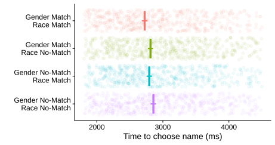
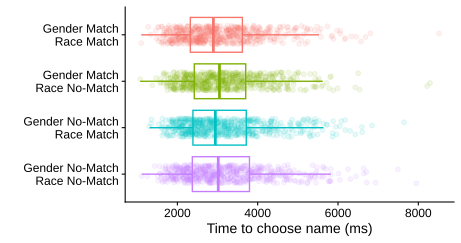

```{r echo=FALSE}
#install.packages("knitcitations") 
library(knitcitations)
#install.packages("rmarkdown")
library(rmarkdown)

```

This is a [template](https://osf.io/brxtd/files/wyxd3) that you can use to report results from reproduction studies in the social sciences. A reproduction is the repeated analysis of a published finding using the same data. Please ensure that the study you intend to report adheres to the following criteria.

**Reproduction is assigned to one original study that tested at least one identical hypothesis.**

- [ ] Reproduction is not “only” a numerical reproduction of the original report’s results but has some added feature (e.g., different software, code, robustness analyses).

- [ ] No original authors have co-authored the reproduction: While involvement of the original authors in the form of consultancy is accepted, *Replication Research* does not publish reproductions co-authored by any of the original author.

- [ ] A dataset from the original study is analysed. If *different* data is used, please use the template for replication studies instead: <https://osf.io/3jgxd>.

- [ ] This is the most recent version of this document (check here: <https://osf.io/wyxd3>).

To complete this template, please provide the information underneath each heading for your study. You need to use a single template for each reproduction study that you want to report. The paper has four main sections: (1) Background; (2) Methods; (3) Results; (4) Evaluation. This template is heavily based on the data paper template by @evans_journal_2024. Some parts (e.g., reproduction closeness) are based on suggestions by @brandt_replication_2014. Before publishing your report, please delete the instructions that are written in blue.

Completed reports can be submitted to the non-peer reviewed [Zenodo Replication Research Community](https://zenodo.org/communities/r2/) or to the peer reviewed journal [Replication Research](https://replicationresearch.org).

## License {.unnumbered}

If you are using this template [@roseler_handbook_2025] or parts of this template to structure your report, please cite it:

Röseler, L., Hein, M., & Oppong Boakye, P. (2025). StaRT Reports.\
https://doi.org/10.17605/OSF.IO/BRXTD



## Title {.unnumbered}

<!--# Describe what phenomenon or finding you have attempted to reproduce (e.g., “Reproduction of Anchoring Effects using River Lengths”). -->

## Abstract {.unnumbered}

<!--# Describe the type of the reproduction, that is, whether it is an assessment of computational reproducibility, a recreation of the script, whether partly different data are being used, and whether robustness checks are planned (see for example @ankel-peters_protocol_2025). The type of reproduction should be justified by the goals of this project (e.g., to test for a false-positive or examine generalizability). -->

The original study by Brough et al. [-@brough2024] investigates how social biases may influence automatic word retrieval mechanisms during sentence production. Across four experiments, the authors observe significant ‘like me’ effects, whereby speakers preferentially mention people who share their own race and gender before naming out‑group members (β = 0.16, SE = 0.02, z = 7.7, p \< 0.001). Psycholinguistic manipulations show that the effect does not vary across grammatical constructions (χ²(2) = 0.65, p = 0.721).

We conducted a computational reproduction using the authors’ original raw data and R scripts, supplemented by reconstruction of some missing scripts/steps, and performed multiple robustness checks (alternative model specifications, alternative exclusion criteria, etc.). Full reproduction of the original statistics was achieved for Studies  1–3. The statistical results of Study 4 were also reproduced except for a sign error.

We conclude that the findings reported in Brough et al. [-@brough2024] are computationally reproducible using the authors’ scripts with some minor adjustments and additions. We also found them to be robust to our modifications. To facilitate future repetitive research and cumulative endeavours, we recommend that multi‑study papers provide detailed README files.

(172 words)

## Keywords {.unnumbered}

like me biases; human language production;

<!--# Provide a maximum of 5 keywords to help quickly communicate the research foci of the reproduction, separated by a semicolon. -->



# Background

<!--# Provide background to the reproduction. This might include a description of the original phenomenon/effect, focal studies about the phenomenon, references where theoretical backgrounds are covered in-depth, whether there have already been reproduction attempts and what their outcomes were, what research rests upon the reproducibility of the phenomenon, or why a reproduction on the topic is informative. Discuss the importance of testing the robustness and reliability of findings via alternate methods. -->

In “Cognitive causes of ‘like me’ race and gender biases in human language production”, Brough et al. [-@brough2024] describe how speakers tend to first mention individuals who resemble their social group. The paper claims that this ‘like me’ effect is due to “(...) automatized mechanisms by which humans retrieve words from memory to produce sentences” [-@brough2024], p. 1706). They demonstrate that the names of individuals who are more similar to the participants are more accessible to the participants.

The focus of the paper is the influence of gender and race. The effect was observed in four different studies. In Studies 1–3, participants had to learn the names of eight persons shown on photographs, who were either Black or white and male or female. They then had to describe events in which two of the persons, differing in either gender or race, engaged in symmetrical interactions. The aim of the studies was to measure “the degree to which participants framed their descriptions in ways that highlighted their own social group, by beginning their sentences with the name of the person who matched them in gender or in race” [-@brough2024: 1707]. Testing both English L1 and L2 speakers as well as Chinese L1 speakers, the authors claim that the ‘like me’ effect is independent of demographic background.

Although the overall ‘like me’ effect was small, with mean values of around 55% [-@brough2024: 1711], the authors conclude that the observed social bias is important. They suggest that the effect is independent of language, linguistic construction, and social group, although Brough et al. [-@brough2024: 1711] acknowledge that the first conclusion is based on just two languages (English and Chinese). According to the authors, “the fact that the like me effect was invariant across constructions suggests that it is driven by accessibility and incrementality, rather than by evaluation” [-@brough2024: 1711]. They claim that “a core conclusion from the present studies is that the incremental and accessibility-driven language system that allows speakers to produce language that is fluent also leads them to produce language that is biased” [-@brough2024: 1711]. Other researchers hope that the large phenomenon of implicit biases will be studied more in the future [-@axt2025] or that counterstereotypical AI can be used to cause a shift to no longer represent certain group members based on stereotypical information which is stored in the memory [-@hermann2025].

The recent study "Exploration of Animacy in the "Like-Me" Effect" [-@halpern] aimed at replicating the original study by Brough et al. (2024) "to see if the Like-Me Effect would occur on the axis of gender, if the characters presented were animated." [-@halpern]. This study failed to replicate a significant overall "Like-Me" effect, but found a significant effect of Gender. Male participants were more likely to produce a "Like-Me" bias than female participants [-@halpern]. Moreover they found that men were more likely to produce a "Like-Me" bias in the animated condition whereas there was not a difference between women and men in the Mixed condition to produce a "Like-Me" response[-@halpern]. One limitation of the replication is, that the sample was not diverse and consisted of 32 students who were all registered in the psychology department at Florida State University. 26 women and 6 men participated and all women were aged between 17-22 [-@halpern].

## Motivation for the present study

To our knowledge the study has not been reproduced. The original study provides open access to their data, stimuli and R scripts as well as to their preregistrations and reviews.

Moreover, as we did have access to the preregistrations, we noticed that the reported models in the paper for Study 2 differ considerably from the models that were preregistered. While the models in the code provided predict the overall ‘like me’ effect with syntax as a sole fixed effect for each of the gender trial and the race trial subgroup, the preregistered models aimed to model participants’ gender and race as fixed effects, as well as trial type and syntax to the models. Moreover the preregistered models for Study 3 differ from the models reported in the article in that they include gender and race as fixed effects. Therefore we performed robustness checks by computing the preregistered models using the provided data.

In Study 4, the authors indicate that the observed ‘like me’ gender effects may be smaller in Chinese because of including two possibly gender neutral chinese names ( 霍普 \[Hope\] and 贝斯 \]Beth\]). Therefore we decided to rerun the analysis for Study 4 with a subset of the data that excluded these two neutral names. We noticed that the main claim made on the basis of these data relies on a GLMM in which the ‘like me’ effect is modelled as a numeric predictor ranging from -1 to 0. However, this variable only has three possible values that, somewhat counterintuitively, correspond to the following: 

- -1 = highest me-likeness (i.e. both race and gender match participant demographic)

- 0 (only race or gender matches participant demographic)

- 1 = lowest me-likeness (neither race nor gender match participant demographic

We believe that this variable would be better modelled as an ordinal categorical variable, hence we reran the reported model with the independent variable modelled as an ordered factor.

## Original and Reproduction Study References

<!--# Provide references with DOIs for the original and reproduction study that adhere to your field’s standard (e.g., APA citation style). If the reproduction study has not yet been published, provide a link to a repository where results and materials are stored (e.g., Zenodo.org, OSF.io). -->

|              | Reference with DOI | Study number |
|--------------|--------------------|--------------|
| Original     |                    |              |
| Study number |                    |              |

## Reproduced Study, Hypothesis, and Findings

<!--# If the original article reported multiple studies, hypotheses, or effects (e.g., for different items or sub-samples) please describe which of these you reproduced and provide its number in the original paper (e.g., 1 or 2A). -->

# Methods

<!--# Describe the methods used for data collection including all sub-headings below as detailed as possible. There is no word limit to this section; we are looking for a carefully detailed account of the data collection methods with sufficient detail to allow further reproductions and meaningful secondary use of the data. -->

## Reproduction type

# **2. Computational Reproducibility**

<!--# Describe the type of the reproduction, that is, whether it is an assessment of computational reproducibility, a recreation of the script, whether partly different data are being used, and whether robustness checks are planned (see for example @ankel-peters_protocol_2025). The type of reproduction should be justified by the goals of this project (e.g., to test for a false-positive or examine generalizability). -->

The original data and code were made available on the OSF (<https://osf.io/87vew/overview>). The repository includes raw and analysis data, as well as cleaning and analysis code in R. As the analysed paper comprises a multitude of studies, we found the total number of subdirectories and files overwhelming. The absence of a ReadMe file made navigating the data packages challenging. 

In the preprocessing scripts for Studies 1–3 (`Process_Study1_Data.R`, `Process_Study2_Data.R`, `Process_Study3_Data.R`) the authors mention that, due to a technical issue involving an unbacked-up computer, the authors no longer have access to all the initial raw data for these studies. However, they provide full access to data files, which have apparently only been hand-corrected for minor spelling mistakes (e.g. 'Rth' instead of 'Ruth'). We therefore classified these files as “raw data provided”. \

|                                 |           |             |        |
|---------------------------------|-----------|-------------|--------|
|                                 | **Fully** | **Partial** | **No** |
| Raw data provided               | x         |             |        |
| Cleaning code provided          | x         |             |        |
| Analysis data provided          | x         |             |        |
| Analysis code provided          | x         |             |        |
| Reproducible from raw data      |           | x           |        |
| Reproducible from analysis data |           | x           |        |

We were able to computationally reproduce the results of Studies 1-3 with the code provided by the authors. The only noticeable difference was a slight change in the numbers of the 95% bootstrapped confidence intervals with a maximal difference of ±0.2, which we believe is due to the way random seeds were set in the R scripts. The function set.seed(), by default, in R only applies to the next operation that involves randomisation. The authors only set a seed at the top of the manuscript and not every time randomisation was intended . <!--# ELF: If I remember right, this was because the authors set a seed at the top of a script and assumed it would apply to all randomised processes but, by default, set.seed() in R only applies to the next operation that involves randomisation. Please check and elaborate here to make clear why the seeds did not work as intended. M: I did check it, it was only once at the very beggining of the scirpt-->

Concerning Study 4, we were unable to fully reproduce two processed data files (`study5_chinese.csv` and `data5_chinese.csv`) from the raw data using the corresponding preprocessing script (`Data Preprocessing/Chinese Study/Process_Chinese_Data.R`). The script returned an error because the column `TrialType` does not exist. We noted that the raw data does include a column entitled `trial_type` which, however, only contains a single unique value: “survey_text”. By contrast, the `Trial_Type` variable contained in the processed data file uploaded by the authors, `data5_chinese.csv`, has two levels, differentiating between “RaceTrial” and “GenderTrial”. We were unable to reproduce this variable on the basis of the raw data, but all other variables were successfully reproduced. For Study 4, we therefore had to use the `study5_chinese.csv` and `data5_chinese.csv` processed data files provided by the authors to reproduce the statistical analyses based on these data. 

Moreover, we were unable to reproduce the median time taken to complete inputting the “critical sentence”, which according to the paper is 9.5 s in the English condition and 8.3 s in the Chinese condition [-@brough2024: 1713]. It was not clear to us what exactly was meant by “critical sentence” and how these could be identified in the datasets. We also observed a minor difference in the final sample size for women in the English condition for Study 4. The paper refers to 28 women [-@brough2024: 1713], but after excluding those with slow RTs, the script `Process_Chinese_Data.R` contains a table with \`condition\`, \`ppt_gender\`, \`list\` and \`n\` in which only 27 English women are listed.

We were able to reproduce the results of the ‘like me’ effect reported as part of Study 4. However, we were unable to locate the code necessary to reproduce some of the values reported in the paper and therefore had to write the code ourselves to check these numbers. This was the case for size of the overall ‘like me’ effect, reported as β = 0.18 (0.04), z = 5.0, P \< 0.001, which we successfully reproduced, as well as the claim that “the size of the effect did not significantly differ depending on the language used” [-@brough2024: 1710], for which we reproduced the same statistics as in the original study apart from one value: we obtained a negative number for the *z*-value (*z* = -1.299) whereas, in the paper, a positive *z*-value (*z* = 1.3) is reported [-@brough2024: 1710]. This sign error is likely to be a typographical error and does not change the claims made in the paper. As with Studies 1-3, we also observed minor differences in the values of the 95% bootstrapped confidence intervals. 

For the Empathy Rating Study, the preprocessing script (`Data Preprocessing /EmpathyStudy/process_data.R`) filtered participants, but did not create the processed dataset used in subsequent analyses. Consequently, it was originally unclear to us whether the data used in the analysis script (`Data Analysis/empathy_study_data.csv`) matches the output of the preprocessing steps. However, we were eventually able to successfully recreate the dataframe used by the original authors, based on an modified version of their preprocessing script, the information provided in the preregistration (<https://aspredicted.org/7698v.pdf>), and the raw data provided by the authors (`Data Preprocessing /EmpathyStudy/full_empathy_data.csv`).

The Agency Rating Study is based on two separate preregistered studies and data collections (one for transitive and one for conjoint constructions), both carried out on Prolific. We were able to successfully reproduce the combined processed dataset from the raw Prolific data using the preprocessing script provided (`Data Preprossessing/Rating Study/process_rating_data.R`). 

We were also able to successfully reproduce all of the plots presented in the paper (see `OSF_Analyses_reproduction.qmd`).

On p. 1709, the authors Brought et al. [-@brough2024] write:

> As Fig. 2a shows, the sizes of the like me effects varied only minimally across the grammatical constructions that we had tested (χ2(2) = 0.65, P = 0.721). Rated agency and rated identification, by contrast, strongly varied based upon the grammatical constructions (both χ2(2) \> 200, P \< 0.001) and clearly dissociated from one another. <!--# ELF: Make sure you correctly format this quote, adding non-breaking spaces whether necessary and the subscript numbers, italics, etc. M: did double check it with the original paper -->

We were unable to reproduce the first chi-square value. Our understanding of the code is that the “Test of grammar” section (from line 1022 of the authors' `OSF_Analyses.R` script) best corresponds to this analysis. This test also returns a non-significant *p*-value (0.4886), but a chi-square value of 2.4272. We were able to reproduce the second chi-square value in the quoted paragraph above as 201.99 for the rated agency (transitive and conjoint sentences) and 820.96 for the rated identification (referred to in the code/data as the Empathy Rating Study). Both correspond to *p*-values that are, indeed, \< 0.001.

We successfully recreated the processed dataset necessary for the analysis of the memory naming task (`studies1_2_3_memory.csv`) based on the raw data using the script `overal_memory_data_processing.R`; however, we noted that this script – which is over 1000 lines long – appears to repeat many of the data processing steps completed in earlier data processing scripts. This is particularly true of the removal of trials and participants according to the exclusion criteria; the latter of which is achieved by filtering out hard-coded participant IDs, which were presumably identified via the visual analysis of the tables produced in the script. It also includes some interactive elements (where the user needs to change a variable multiple times to check various subsets of the data) and many repeated code chunks within the script, too, making it difficult to check for consistency. In spite of the presence of comments in the code, it is difficult to follow the logic of the various data wrangling steps. As delivered, this preprocessing script <!--# ELF: Or is this a data processing script? M: yes, it is in the folder Data_Preprocessing_original --> is not reproducible.

The main result of the memory naming experiment could be reproduced (β = 0.02 (0.005), t(642) = 4.5, p \< 0.001). The mean reaction times reported on pp. 1709–1710 could all be reproduced. The bootstrapped confidence intervals differed slightly, but this is not surprising as no random seed was set in the `overall_memory_analysis.R` script.

For the Multi-Study analysis, which combines the data across Studies 1 through 3, the Methods section [-@brough2024: 1712ff.], describes what is being investigated in that part of the paper: 

> We analysed the effect of syntax across the first three studies using a regression of the form LikeMe \~ 1 + Grammatical Frame + (1\|subject) + (1\|event).
>
> \[...\]
>
> The main omnibus analyses used mixed-effects regressions of the form LikeMe \~ 1 + Participant Gender × Participant Race + (1\|subject) + (1 + Participant Gender × Participant Race\|event). Predictors were contrast coded, and separate models were fit to the race and gender trials. The analysis of trial type (using data from all four production studies) had the form LikeMe \~ 1 + Trial Type \[Gender versus Race-focused\] + (1 + Trial Type\|subject) + (1 + Trial Type\|event)” [-@brough2024: 1713f.].

These regression models can be found in the code provided by the auhors `R_scipts/scripts_and_data_original/Data_Analysis_Original/OSF_Analyses.r` ( <!--# ELF: Add file path plus name here, M: did add it -->) and match the descriptions in the paper. We successfully reproduced the results of these analyses.

## Original and Reproduction Study Features

<!--# Provide a clear overview of the hypothesis, original study, and reproduction study. Describe all differences between the studies using the table below, highlighting any changes or enhancements in the analysis procedures from the original work. -->

**Table 1** *Differences Between the Original and the Reproduction Study*

+-----------------------+----------------+--------------------+-------------------------------------------------------+
| Study Feature         | Original Study | Reproduction Study | Justification and Possible Effect on Interpretability |
+=======================+================+====================+=======================================================+
| Software and versions |                |                    |                                                       |
+-----------------------+----------------+--------------------+-------------------------------------------------------+
| Functions             |                |                    |                                                       |
+-----------------------+----------------+--------------------+-------------------------------------------------------+
| ...                   | ...            | ...                | \[press Tab here to add new rows\]                    |
+-----------------------+----------------+--------------------+-------------------------------------------------------+

## Involvement of Original Authors

<!--# Describe whether you have contacted any of the original authors, what their recommendations were, and all materials that they provided you with. Original authors cannot be co-authors on the reproduction study if you plan to submit it to Replication Research.  -->

Did original authors provide:

- Code/data? → Permitted (non-authorship) 

- Analysis input? → Permitted (non-authorship) 

- Draft revisions? → NOT permitted (co-authorship)



## Preregistration

<!--# If applicable, provide the links for the original and reproduction study’s preregistration. @ankel-peters_protocol_2025 recommend preregistering robustness checks after gaining familiarity with data and code but before implementing new analyses -->

| Study        | Preregistration link |
|--------------|----------------------|
| Original     |                      |
| Study number |                      |

<!--# M: Auflistung der preregistrations unter 2.1.1 und nicht in der Tabelle.-->

### Discrepancies Between Pre-analysis Plan and Article

The first challenge in comparing the preregistered analyses with the analyses reported in the article consisted in matching the preregistrations with the relevant study and results. We begin this section by reporting on our understanding of these matches before proceeding with a study-by-study comparison of pre-analysis plans and reported analyses.

#### 2.1.1 Overview of preregistrations

The article provides links to the following Experimental Study preregistrations:

- Study 1: <https://osf.io/bfhrn> (06 June 2019)

- Study 2: <https://osf.io/t928m> (10 February 2020)

- Study 3 (passives): <https://osf.io/drb6f/overview> (11 October 2021)

Study 4 (Chinese Study) was not preregistered and is reported as such in the paper [-@brough2024: 1712] . In addition, a secondary analysis of the memory naming task (that was part of Studies 1–3) was preregistered a few years later: <https://aspredicted.org/jf9cn.pdf> (17 November 2023)

The preregistrations for the Rating Studies are distributed across three documents:

- Agency Study, transitive condition: “Does mention order influence perceptions of agency in conjoined phrases?” registered on 10 December 2020 at <https://osf.io/zp5d4/overview>. The second hypothesis (“Based off the previous experiment, we also predict that participants will be more likely to rate the first-mentioned name as agentive if it is a man’s name rather an a woman’s name.”) as well as the interaction between the gender of the first-mentioned name and participant gender were not tested in the available analysis scripts and not reported in the paper.

- Agency Study, conjoined condition: “Does mention order influence perceptions of agency?” registered on 23 November 2020 at <https://osf.io/rh9sd/overview>

- Agency Study, passive condition and Empathy Study: “Intuitions analysis for Like Me study” (Study 1: judgements of agency in passive constructions; Study 2: judgements of empathy in conjoined, transitive, and passive sentences), registered on 21 November 2023 at <https://aspredicted.org/7698v.pdf>

Although each preregistration document was clearly formulated, the distribution of the preregistered studies and conditions did not correspond to the organisation of the Rating Studies in the paper, making it challenging for us to reconstruct the mapping between the preregistered analyses and the reported results.

#### 2.1.2 Pre-analysis plan of Study 1

For Study 1, we found that the analysis code matches the descriptions of the analysis plan in the preregistration (<https://osf.io/bfhrn>). Brough et al. [-@brough2024] created two subsets for each gender and race trials, computing four separate generalized linear mixed-effect models (GLMM) with \`syntax\` as a fixed predictor. Although the exact syntax of these models is not provided in the preregistration, the code for the GLMMs reflects the description:

OverallLikeMe \~ 1 + syntax + (1+syntax\|subject) + (1+syntax\|event)

This model is applied to the overall data, to each gender and race trials and to all possible gender and race subsets (white man, white woman, black man, black woman). The preregistered inference criteria reads: “We will use the standard p \< .05 criteria for determining if the regressions suggest that the results are significantly different from those expected if the null hypothesis were correct.” Given that a total of seven GLMMs were conducted on the same dataset or subsets of the data, we were surprised that no mention was made of any p-value corrections.

#### 2.1.3 Pre-analysis plan of Study 2

For Study 2, the analysis code differs from the preregistration (<https://osf.io/t928m>) in several ways. The provided code replicates the same models from Study 1 for the new data collected with improved stimuli in Study 2. A generalized linear mixed model was built for the overall data, for each race and gender trials, and for the gender and race subsets. The Methods section for Study 2 in the paper [-@brough2024: 1712] explains that the same regression models were used as in Study 1. The preregistration, however, describes a more complex modeling strategy. Several preregistered analyses, including valence effects, questionnaire-based regressions, interaction tests and secondary control analyses, were not implemented in the available code. For the primary analysis, the authors preregistered an iterative approach to model building, looking at predictors of using the dominant group (man or white person) first. They start by including participant race and gender (a), then trial type (b), and finally syntax (c) as predictors of first mention of the dominant group:

1.  Man First/White First \~ Participant Gender \* Participant Race + (1 \| Subject) + (1 + Participant Gender + Participant Race \| Event).

2.  Man First/White First \~ Participant Gender \* Participant Race \* \[Gender Trial Type or Race Trial Type\] + (1 + \[Gender Trial Type or Race Trial Type\] \| Subject) + (1 + Participant Gender + Participant Race \| Event).

3.  Man First/White First \~ Participant Gender \* Participant Race \* \[Gender Trial Type or Race Trial Type\] \* Syntax + (1 + \[Gender Trial Type or Race Trial Type\] + Syntax \| Subject) + (1 + Participant Gender + Participant Race \| Event).

None of these models, however, are provided in the analysis code and they are not mentioned in the paper.

In terms of the ‘Like me’ analysis, the preregistered analysis plan specified mixed-effects logistic regression models including participant gender, participant race, trial type, syntax, and their interactions in a similar iterative approach:

4.  Like Me Gender/Race \~ Participant Gender \* Participant Race + (1 \| Subject) + (1 + Participant Gender + Participant Race \| Event).

5.  Like Me Gender/Race \~ Participant Gender \* Participant Race \* \[Gender Trial Type or Race Trial Type\] + (1 + \[Gender Trial Type or Race Trial Type\] \| Subject) + (1 + Participant Gender + Participant Race \| Event).

6.  Like Me Gender/Race \~ Participant Gender \* Participant Race \* \[Gender Trial Type or Race Trial Type\] \* Syntax + (1 + \[Gender Trial Type or Race Trial Type\] + Syntax \| Subject) + (1 + Participant Gender + Participant Race \| Event).

However, the analyses in the provided code only include syntax as the sole fixed effect, with participant demographics and trial type addressed only via data subsetting rather than factorial modeling:

OverallLikeMe \~ 1 + Syntax + (1 + Syntax \| Subject) + (1 + Syntax \| Event)

For both of the described analyses, the authors preregistered additional models with valence condition as a fixed effect, along participant gender, participant race, trial type and syntax, as predictors of the man first, white first, Like Me Gender and Like Me Race biases. These models are neither provided in the analysis code, nor mentioned in the paper.

For the final analysis of Study 2, Brough et al. [-@brough2024] preregistered regression models to analyse questionnaire data that contains participants’ attitude towards homosexual and interracial relations, using them as predictors of demonstrating Like Me Race bias. As far as we could see, these models are not in the provided code either. As with Study 1, neither the preregistration nor the code or the paper seem to make any provisions to correct for the multiple testing problem.

#### 2.1.3 Pre-analysis plan of Study 3

For Study 3, the preregistration (<https://osf.io/drb6f/>) differs considerably from the conducted Study. As a first difference, the authors preregistered valence as an independent variable with the levels intimate, casual and negative. As far as we can tell, this variable is not mentioned in the article. The authors also preregistered “exploratory models for each of the valence conditions” which we were unable to locate in the code or paper.

The authors preregistered two regression models to test their primary hypotheses of “Man First” and “White First”:

1.  Man First \~ Participant Gender \* Syntax + (1 + Syntax \| Subject) + (1 + Participant Gender \| Event)

2.  White First \~ Participant Race \* Syntax + (1 + Syntax \| Subject) + (1 + Participant Race \| Event)

Similar to Study 2, these models are not reported in the article and, as far as we could tell, nor are they implemented in the analysis code.

Regarding the ‘like me’ effect, the models reported in the article and implemented/ present in the code test whether participants show a ‘like me’ effect in gender/race trials. The authors preregistered mixed-effects regression models with gender and race as fixed effects to test whether the ‘like me’ effect depends on participant gender or race (that is, whether one gender shows a stronger ‘like me’ than the other gender/race) and, additionally, whether that effect is moderated by \`syntax\` (interaction of gender and syntax):

1.  Like Me Gender \~ Participant Gender \* Syntax + (1 + Syntax \| Subject) + (1 + Participant Gender \| Event)

2.  Like Me Race \~ Participant Race \* Syntax + (1 + Syntax \| Subject) + (1 + Participant Race \| Event)

However, these models were not reported in the article. Similar to Study 2, the analysis in the provided code includes \`syntax\` as the only fixed effect:

OverallLikeMe \~ 1 + syntax + (1+syntax\|subject) + (1+syntax\|event)

Instead, the authors performed and reported subgroup analyses for the groups of black women, black men, white women, and white men. As they preregistered, they expected that each participant would most likely mention the figure first that matches their group.

The preregistration also includes preregistered analyses of questionnaire data which we were not able to locate in the analysis code.

#### 2.1.4 Pre-analysis plan of the Rating Studies

Our recreation of the empathy analysis data on the basis of the preprocessing script (`Data Preprocessing /EmpathyStudy/process_data.R`) and the raw data (`Data Preprocessing /EmpathyStudy/full_empathy_data`) confirmed that the dataset was derived from the original 128 participants, with 19 participants who failed 2 or more catch trials excluded. This differs from the preregistration (<https://aspredicted.org/7698v.pdf>), which specified excluding participants who answered more than 2 catch trials incorrectly. No additional exclusion criteria appear to have been applied. This potentially differs from the preregistration, which stated that trials with response times more than 3 SD from the mean, participants whose self-reported gender did not match Prolific records, and participants who had reported not to have lived in the UK for the last five years would be excluded. While these additional exclusion criteria might not have been relevant or may have been applied earlier on in the process, the preprocessing code of the Empathy Rating Study does not check for them.

By contrast, all of these preregistered exclusion criteria are applied in the processing scripts for the Rating Studies featuring transitive and conjoint constructions, except that, as with the Empathy Study, the exclusion criteria for failed catch trials implemented in the preprocessing scripts is also \> 2 rather than ≥ 2 failed catch trials as specified in the corresponding preregistrations ([https://osf.io/rh9sd/](https://osf.io/rh9sd/overview) and <https://osf.io/zp5d4/>). The processing script for the passive Rating Study does not include checks for any potential exclusion based on demographics.

The main claims of the paper are based on comparisons of models made with aggregated data from the various Rating Studies. As far as we can tell, these were not preregistered.

#### 2.1.5 Pre-analysis plan of the Omnibus Studies

For the Multi-Study analyses, the preregistration does not appear to match the actual methodology for the analyses conducted across the first four Studies. The preregistration plan on AsPredicted (<https://aspredicted.org/jf9cn.pdf>) describes a different experiment that is part of the paper, namely the study on participants’ reaction times, where the authors measure whether the participants’ response speed is predicted by whether the character matches the participant in either race or gender. The actual preregistration contains the following analyses:

For each accurate 8AFC response with RT \< 10s, we predict logged RT in a mixed effects model by

1\) Whether the character matches the participant's race \_and\_ gender (coded 1 in a dummy variable) or not (coded 0), i.e.,

lmer(log(rt) \~ OverallLikeMe + (1+OverallLikeMe\|id)

2\) Whether the character matches the participant's race i.e.,

lmer(log(rt) \~ like_me_race + (1+like_me_race\|id)

3\) Whether the character matches the participant's gender i.e.,

lmer(log(rt) \~ like_me_gender + (1+like_me_gender\|id)

3\) Whether the character matches the participant's gender and race exactly (coded 1), matches only one feature (coded 0), or matches no features (coded -1)

lmer(log(rt) \~ like_me_graded + (1+like_me_gender\|id)

Although these analyses are conducted in a different section of the paper, the main omnibus analyses reported in the paper (see [-@brough2024: 1714]for model formula) appear not to have been preregistered.

## Availability of Materials

<!--# Provide an overview of all materials (raw and processed data, code), where to find them (e.g., openly accessible, shared upon request, accessible via a specific institution, access protocol), and, if applicable, what license they are under. -->

# Results

<!--# Describe potential changes that had to be made so that the reproduction could work (e.g., choosing specific software versions, fixing errors or typos, switching to other methods). Use the sections below and table to report findings from the original and reproduction study. -->

## Original key statistical result and interpretation

+--------------------------------------------+-------------------------------------------------+---------------------+
| Claim                                      | Key results and interpretation                  | Reproduction result |
+============================================+=================================================+=====================+
| Please provide the original                |                                                 |                     |
+--------------------------------------------+-------------------------------------------------+---------------------+
| authors’ claim and page number             | Key statistical result from the original report |                     |
+--------------------------------------------+-------------------------------------------------+---------------------+
| Correlations between variables of interest | Table 1                                         | Table 2             |
+--------------------------------------------+-------------------------------------------------+---------------------+
| Relationship between variable x, y, and z  | Figure 4                                        | Figure 2            |
+--------------------------------------------+-------------------------------------------------+---------------------+

## Comparison of Results Between Original Study and Reproduction

<!--# Report original and reproduction results and evaluate their similarity. Comment on the impact of using different analytical methods on the original findings (“robustness reproduction”, @ankel-peters_protocol_2025). Discuss whether the conclusions of the original study are upheld or reconsidered. -->

## Further results

<!--# If you conducted any sort of robustness checks, extensions or auxiliary/exploratory analyses, you can report them here. Include a justification for each robustness check. Beyond individual checks, you can also include specification curves. -->

### Robustness Checks

We conducted a total of 4 robustness checks. <!--# M: Robustness checks von Study 2-4 gekürzt, noch unklar, wie ich auf den Report verweisen soll, da wir ihn bisher nicht veröffentlicht haben -->

For Study 2, we ran the preregistered 2\*2 models on each the gender trial data subset and the race trial subset: Like Me Gender/Race \~ Participant Gender\* Participant Race + (1 \| Subject) + (1 + Participant Gender + Participant Race \| Event).

In both cases, the maximal random-effects structure specified in the preregistration failed to converge.In line with the preregistration, which specified that random effects accounting for the least variance and interactions preventing convergence would be iteratively removed, we simplified the random-effects structure by first removing the random slopes for participant gender and participant race at the event level, since the event-level slopes have near-zero variances:

Like Me Gender/Race \~ Participant Gender \* Participant Race + (1 \| Subject) + (1 \| Event)

Despite these adjustments and the use of the “bobyqa” optimizer, the model continued to exhibit singularity warnings, indicating that the remaining random-effects structure was still unsupported by the data. Only after removing all random effects did the model converge. However, we deem this simplification as highly problematic, as it eliminates the ability to account for individual variance within participants and systematic differences across verbs. Nonetheless, we used the converged model as an approximation to the preregistered analyses. To facilitate interpretation of the fixed effects and to allow comparison with the reported descriptive results, we computed estimated marginal means using the emmeans package. For the race trial subset, the preregistered mixed-effects model failed to converge as well. Convergence could, again, only be achieved by eliminating all random effects resulting in a fixed-effects-only logistic regression. The model output (Table 3) indicates that this model explains virtually no variance in the data (Tjur’s R2 = 0.000). None of the fixed effects, i.e. participant gender, participant race, or their interaction, significantly predict the likelihood of showing a ‘like me’ effect on race trials. This suggests that, under the preregistered modeling framework, there is no detectable evidence for systematic variation in ‘like me’ biases on race trials across participant groups.

For Study 3 we performed a robustness check by computing the preregistered models using the provided data. For gender trials, the preregistered model yielded almost identical results to the model reported in the article. In both the preregistered and the reported model, participants chose the same-gender character first in 55.9% of trials. The intercept was significant, confirming an overall ‘like me’ effect in gender trials (i.e. both men and women were, on average, biased toward their own gender). Fixed effects (participant gender, syntax and their interaction) had no significant effects, in line with Brough et al.’s [@brough2024 : 1709] statement that there was no significant difference between men and women concerning their ‘like me’ effect and no difference between active and passive sentences.

The analogous preregistered race model, fit to race trials, showed no clear evidence for a ‘like me’ effect. Again, the values computed by the preregistered model match closely the ones reported by the authors (Table 4). Participant race and syntax were not significant, neither was their interaction, indicating no significant difference between White and Black participants and no difference between active and passive in race trials.

The maximal preregistered models only converged when using the “bobyqa” optimizer and produced boundary (singular) fit warnings, indicating that the random effects explain little to no variance. This may explain why the authors decided not to report the preregistered models.

In sum, implementing the preregistered model as a robustness check of Study 3 had no effect on the magnitude or the statistical significance of the main point estimate.

For Study 4 we excluded neutral chinese names as the authors indicate that the observed ‘like me’ gender effects may be smaller in Chinese because of including two possibly gender neutral chinese names ( 霍普 \[Hope\] and 贝斯 \]Beth\]). Indeed, when excluding neutral names, the ‘like me’ effect are larger than those reported in the paper.

#### Robustness check (Study 5): Memory naming task

We noticed that the main claim made on the basis of these data relies on a GLMM in which the ‘like me’ effect is modelled as a numeric predictor ranging from -1 to 0. However, this variable only has three possible values that, somewhat counterintuitively, correspond to the following: 

- -1 = highest me-likeness (i.e. both race and gender match participant demographic)

- 0 (only race or gender matches participant demographic)

- 1 = lowest me-likeness (neither race nor gender match participant demographic

We believe that this variable would be better modelled as an ordinal categorical variable, hence we reran the reported model with the independent variable modelled as an ordered factor.

The coefficient of interest turns out to be robust to this manipulation. It is of a similar size than the reported coefficient and also statistically significant (see Table 6). Note that in both the model reported in the paper and this additional model, the LikeMeFeature predictor accounts for just 0.01% of the variance in participants’ recall times. This statistic is not reported in the paper.

|                        |             |               |             |
|------------------------|-------------|---------------|-------------|
| *Predictors*           | *Estimates* | *CI*          | *p*         |
| (Intercept)            | 7.92        | 7.90 – 7.94   | **\<0.001** |
| LikeMeFeatureNumeric L | 0.03        | 0.02 – 0.04   | **\<0.001** |
| LikeMeFeatureNumeric Q | -0.01       | -0.02 – -0.00 | **0.038**   |

| *Random Effects*              |               |
|-------------------------------|---------------|
| σ²                            | 0.18          |
| τ~00 id~                      | 0.07          |
| τ~11 id.LikeMeFeatureNumeric~ | 0.00E         |
| ρ~01 id~                      | 0.11          |
| ICC                           | 0.28          |
| N ~id~                        | 622           |
| Observations                  | 22482         |
| Marginal R² / Conditional R²  | 0.001 / 0.283 |

: Table 6: Summary of model with ordered factor predictor variable **log(rt)**

<!--# M: nicht sicher wo das log(rt) genau hingehört? In dem report steht es unter der Überschrift und über CI in der Tabelle (S. 21) -->

In the original analysis of the memory naming task, the authors removed trials for which participants needed longer than 10 s to name the images (as preregistered). Below are the descriptive statistics of the response time variable for the trials that were included in this analysis (i.e. first guesses only, correct responses only, and excluding participants with strong biases). It turns out that 10,000 ms is much longer than most people needed to recall the names:

|      |         |        |      |         |         |
|------|---------|--------|------|---------|---------|
| Min. | 1st Qu. | Median | Mean | 3rd Qu. | Max     |
| 298  | 1891    | 2627   | 3663 | 4040    | 1234104 |

At the same time, we noted that the overall_memory_analysis.R script produces a plot which illustrates the difference in response time across the four conditions. This plot, which is not included in the final version of the paper, shows that the differences in mean response times are very small, that the confidence intervals overlap, and that there is considerable variation across the entire dataset (see Fig. 1). In fact, not all of this variation is visible as the plot cuts the x-axis off at 4,500 ms, thereby removing 366 data points.

When we visualise all the data points entered into the reported model as boxplots, a rather different picture emerges (see Fig. 2). The pattern in median response time does not match the reported effect.





Bearing in mind the outliers visible in Fig. 2, we reran the analysis with a more conservative cut-off point of 6 s than that of 10 s preregistered and applied by the authors (corresponding to 91% of the trials analysed by authors) to test the robustness of the reported effect. The differences in both observed and predicted mean reaction times across the three conditions are smaller than those reported, but remain nonetheless significant. We also reran the model on this subset of the data. The results remain broadly the same (see Table 7).

+-----------------------------------------------------------------------------------------------------------------------------------------------------------------------------+--------------------------------+----------------------+
| **Claim in the original study\                                                                                                                                              | **Computational reproduction** | **Robustness check** |
| (as reported on p. 1709-1710)**                                                                                                                                             |                                |                      |
+=============================================================================================================================================================================+================================+======================+
| Response times significantly increased as demographic match decreased                                                                                                       | β = 0.020656                   | β = 0.017077         |
|                                                                                                                                                                             |                                |                      |
|                                                                                                                                                                             | (0.004641)                     | (0.003973)           |
|                                                                                                                                                                             |                                |                      |
|                                                                                                                                                                             | t(642) = 4.451                 | t(613) = 4.298       |
|                                                                                                                                                                             |                                |                      |
|                                                                                                                                                                             | p = 0.0000101                  | p =0.00002           |
+-----------------------------------------------------------------------------------------------------------------------------------------------------------------------------+--------------------------------+----------------------+
| Participants were fastest to select names when they matched the figures on both gender and race                                                                             | 2,724 ms                       | 2,548 ms             |
|                                                                                                                                                                             |                                |                      |
|                                                                                                                                                                             | \[2,642–2,801\]                | \[2,488–2,612\]      |
+-----------------------------------------------------------------------------------------------------------------------------------------------------------------------------+--------------------------------+----------------------+
| When participants matched the figures in gender but differed in race (and, thus, the forms of names were perfectly counterbalanced), then responses were about 90 ms slower | 2,813-2,724 = 89 ms            | 2,639-2,548 = 91 ms  |
|                                                                                                                                                                             |                                |                      |
|                                                                                                                                                                             | \[2,734–2,898\]                | \[2,575–2,703\]      |
+-----------------------------------------------------------------------------------------------------------------------------------------------------------------------------+--------------------------------+----------------------+
| When participants matched in race but differed in gender, then responses were about 70 ms slower                                                                            | 2,794-2,724 = 70 ms            | 2,605-2,548 = 57 ms  |
|                                                                                                                                                                             |                                |                      |
|                                                                                                                                                                             | \[2,713–2,886\]                | \[2,538–2,673\]      |
+-----------------------------------------------------------------------------------------------------------------------------------------------------------------------------+--------------------------------+----------------------+
| Finally, when participants differed from the figures in both gender and race, they were an additional 50 ms slower to name them                                             | 2,856-2,794 = 62 ms            | 2,662-2,605 = 57 ms  |
|                                                                                                                                                                             |                                |                      |
|                                                                                                                                                                             | \[2,769–2,946\]                | \[2,595–2,728\]      |
+-----------------------------------------------------------------------------------------------------------------------------------------------------------------------------+--------------------------------+----------------------+
| **Model performance metrics**                                                                                                                                               |                                |                      |
+-----------------------------------------------------------------------------------------------------------------------------------------------------------------------------+--------------------------------+----------------------+
| N                                                                                                                                                                           | 22482                          | 12311                |
+-----------------------------------------------------------------------------------------------------------------------------------------------------------------------------+--------------------------------+----------------------+
| Marginal R2 / Conditional R2                                                                                                                                                | 0.001 / 0.287                  | 0.001 / 0.282        |
+-----------------------------------------------------------------------------------------------------------------------------------------------------------------------------+--------------------------------+----------------------+

: Table 7 – Results of robustness check on naming memory task analysis

## Dataset and Materials link

<!--# Please include a permanent identifier, such as a DOI, that points to the online location of the dataset and all used materials. If this resource has already been accessible, a new DOI is not required. -->

## Object/file name

<!--# Please note the exact name of the dataset used to arrive at the reproduction results (e.g., data.csv). -->

## Limits to sharing

<!--# If the data is currently under embargo, please give the length and date at which the data will be made open. Otherwise, please note any potential barriers to full sharing of the data e.g., if it contains identifying information, how gatekeeping is maintained. Please note that you will need to provide full access to the project contributors and potential reviewers for the sake of transparency, in full confidentiality. -->

## FAIR data/Codebook

- [ ] Data deposited in certified repository (e.g., OSF, Zenodo)

- [ ] Dataset has persistent identifier (DOI)

- [ ] Code shared with open license (e.g., MIT, GPL)

- [ ] Codebook includes:

  - [ ] Variable names Description
  - [ ] Valid ranges
  - [ ] Missing codes

- [ ] Metadata uses standard schema (e.g., Datacite, CodeMeta)

- [ ] File formats are non-proprietary (e.g., .csv, .txt, .R)

## Deviations from the Preregistration

<!--# If applicable, discuss for each deviation from the preregistration (1) how you deviated, (2) why you did so, and (3) how this might affect the results. Please also list cases where the preregistration was unspecific and you had to make decisions after data collection (e.g., no preregistered exclusion criterion, hypothesis test was not specified as one- vs. two-tailed). If you did not deviate in any way, write “We did not deviate from the preregistration in any way.” In cases where two different sets of results could be obtained (e.g., one- and two-tailed test), please describe the results for both cases. -->

+--------------------------+----------------------+--------------------------+
| Description of Deviation | Reason for Deviation | Influence on the Results |
+==========================+======================+==========================+
| ...                      | ...                  | ...                      |
+--------------------------+----------------------+--------------------------+
|                          |                      |                          |
+--------------------------+----------------------+--------------------------+

## FORRT Replication Database (FReD) Entry

Please disclose whether your results have already been entered into the replication database. To check it, you can enter the DOI of the target study here: <https://forrt.org/apps/fred_annotator.html>. If they are, we will link this report to the entry. If they are not, we invite you to enter them in the spreadsheet or in case of a low number of replication effects here: <https://docs.google.com/forms/d/e/1FAIpQLSeMCwdtP0TPgL55stniuyyTxnNwyC34mO4VUuLcQwYrLI89sQ/viewform>.

# Evaluation

<!--# Please describe everything you learned from your reproduction. This may include acknowledging strengths and limitations of the original or reproduction study or materials, recommendations for future research on the topic, or how the findings are related to other studies in the area or previous reproduction studies. The evaluation should further cover computational reproducibility, robustness, and optionally external validity. -->

## Feedback from the original study’s authors (optional)

You may reach out to the original authors. In this case, we recommend adhering to the “golden rule of reproductions: treat others and their work, as you would like others to treat you and your work!” [@berkeleyinitiativefortransparencyinthesocialsciencesteam2020]. For email templates, see the ACRE guide: <https://bitss.github.io/ACRE/comunications.html#for-reproducers-contacting-the-authors-of-the-original-study>

Original authors were contacted on \[date\].\
Their response:\

- [ ] Comments appended

- [ ] Declined to comment

- [ ] No response after 4 weeks.

If no response, editors may independently solicit feedback.

## Limitations and Recommendations for Future Replications

<!--# Discuss your study’s limitations (e.g., in terms of validity) and make recommendations for what future studies related to this topic should consider. -->

## Brief Evaluation

<!--# Describe in up to two sentences the level of reproducibility. If you use a specific metric such as reproducibility score, describe that metric. -->



Other information required for submission, not for review

# Contribution Statement {.unnumbered}

<!--# Please list all contributions towards this manuscript, including the contributions of all individuals who helped to conduct the data (who may also not be an author of a potential publication regarding this study), including their roles and affiliations at the time of data collection. We explicitly encourage you to include students or research assistants if they were involved in designing or conducting the study. -->

# Ethical Statement {.unnumbered}

<!--# Please provide an appropriate ethical statement if your work involves live subjects (human or animal). For example, the research should have been conducted in accordance with the Declaration of Helsinki and local requirements. -->

# Acknowledgements {.unnumbered}

Please add any relevant acknowledgements to anyone else who supported the project in which the data was collected, but did not work directly on the data itself.

# Conflicts of interest {.unnumbered}

are defined as “when authors, reviewers, or editors have interests that are not fully apparent and that may influence their judgments on what is published. They have been described as those which, when revealed later, would make a reasonable reader feel misled or deceived” (COPE, 2003). Please note any potential conflict of interests, including but not limited to direct or indirect financial gains or non-financial implications. If you have no conflicts to declare, please state explicitly: “The author(s) declare no conflict of interest associated with the publication of this manuscript.

# Funding statement {.unnumbered}

If the data, or the project from which it came, required funding, please provide clear detail of this here. For example, if funded by a research council this would include the year of successful receipt of funding, the name of the funding council, and the grant number.



# References {.unnumbered}

Please enter references (preferably in the APA style) and include a DOI where available.
